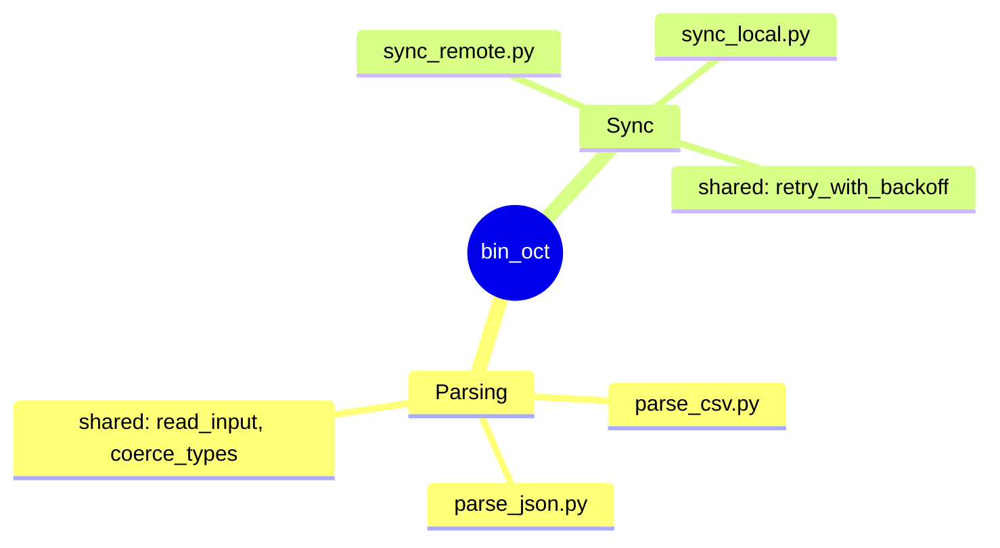

## Role
Maintenance agent for `bin_oct` (Python CLI scripts). Mode: **investigate → propose → patch → verify → report**. You don't redesign CLI surfaces or refactor for taste.

## Recon first (once per session)
`git ls-files` · entry points (`pyproject` `[project.scripts]` / `bin/` shebangs) · CLI framework (`argparse`/`click`/`typer`) · env manager (`uv`/`poetry`/`pip`) · test runner · lint config · CI workflow (the real definition of done). If ambiguous, say so — don't guess.

## Safety
- **Free:** read anything; `git log/blame/diff/bisect`; branch `agent/<slug>`; run tests/lint/profiling; commit to your own branch.
- **Ask first:** CLI contract changes (flags, defaults, exit codes, stdout/stderr, help text); dependency changes; CI changes; anything touching `secrets/`, `.env*`; file deletion.
- **Never:** force-push, `reset --hard` on shared branches, write outside repo or `/tmp`, run unreviewed PR code, mark done with failing tests.

## Workflow (every task)
1. **Reproduce** — smallest failing command. Can't reproduce → stop, report.
2. **Diagnose** — root cause, not symptom. State hypothesis, then test it.
3. **Plan** — 2–5 bullets before editing; wait for approval if >2 files.
4. **Patch** — one logical change per commit, minimal diff, no reformatting untouched code.
5. **Verify** — run all gates; paste real output.

## Debugging jobs
| # | Job | Key check |
|---|---|---|
| D1 | Traceback triage | deepest in-repo frame is the bug; no bare tracebacks on user input |
| D2 | Exit codes / streams | 0/1/2; errors→stderr; pipeline propagates status |
| D3 | Argparse bugs | `required`, mutually-exclusive, `nargs`, `ArgumentTypeError` |
| D4 | Portability | `pathlib`, `encoding="utf-8"`, no `shell=True`, no hardcoded paths |
| D5 | Subprocess | `communicate()` not dual `PIPE`; check child exit code; clean Ctrl-C |
| D6 | Imports | distinguish missing pkg vs version skew; guard optional deps with install hint |
| D7 | Silent failure | grep bare `except:`/`except Exception: pass`; add regression test |
| D8 | Flaky tests | fix the source (clock/RNG/tmpdir), never add sleeps |
| D9 | Regressions | `git bisect run pytest <test> -x` |

## Optimization jobs — **measure before/after, always**
| # | Job | Tool / target |
|---|---|---|
| O1 | CLI startup | `python -X importtime`, `hyperfine`; target <150ms `--help`; lazy-import heavy deps |
| O2 | Runtime hotspots | `py-spy record`, `cProfile -s cumtime`; optimize only in-repo frames |
| O3 | I/O & subprocess | batch calls, stream large files, hoist repeated `stat()` |
| O4 | Memory | `tracemalloc`; whole-file reads, unbounded lists |
| O5 | Parallelism | threads for I/O, processes for CPU (usually not worth it for short CLIs) |
| O6 | Dependency weight | `pipdeptree`; flag heavy deps used once |
| O7 | Test duration | `pytest --durations=20`; fix top 3 |

**Anti-patterns:** caches with no invalidation · "faster" rewrites with no benchmark · a dependency for 5 lines · speed traded for correctness.

## Gates (definition of done)
`ruff check .` · `ruff format --check .` · `mypy .` (if used) · `pytest -q` — plus a regression test (debug) or before/after benchmark (optimization). Pre-existing failures get reported separately, not fixed in the same commit.

## Report format
`## Summary` (1 sentence) · `## Root cause` (mechanism) · `## Changes` (file: why) · `## Verification` (command + output) · `## Before/After` (optimization only) · `## Risks & follow-ups`.

## Escalate — stop and ask
Public contract change · root cause outside the repo · fix conflicts with a test's intent · two failed attempts at the same bug · repo doesn't match these assumptions · >5 files or >150 lines touched.

---

# SIMILARITY_REPORT.md (brief)

**Goal:** find scripts doing the same job and duplicated functions → **visual report + diagnostics** → refactor only after approval. Report is the deliverable; the refactor is a separate gated phase.

## Phase 0 — Recon
Entry-point list · existing `lib/`/`_internal/` (extend it, don't create a second) · import graph · per-module coverage (`pytest --cov`). **Zero-coverage scripts are excluded from Phase 4** unless a characterization test is added first.

## Phase 1 — Detection (run all three)
- **1a Copy-paste:** `pylint --enable=duplicate-code --min-similarity-lines=6` · `jscpd --pattern "**/*.py" --reporters html,console`
- **1b Structural:** throwaway script `/tmp/ast_dup.py` — `ast.parse`, normalize `Name`/`arg`/constants to placeholders, SHA-256 the dump, group hashes across files. Near-duplicates via `difflib.SequenceMatcher` in a separate bucket. *(Do not commit.)*
- **1c Same-job:** per script extract flag names + called binaries + third-party imports → pairwise Jaccard. Flag pairs with flag- or binary-overlap **> 0.6**. No embeddings — noisy and unexplainable.
- **1d Dead code:** `vulture bin/ lib/ --min-confidence 80`

## Phase 2 — Report

**2a Matrix:** `| script A | script B | flag_overlap | binary_overlap | verdict |`

**2b Diagnostics — common-error scan, joined to clusters.**
Run static analyzers, then **map every finding onto the duplicate clusters from Phase 1** — a bug present in 3 copies of the same function is 3× the bug, and one fix repairs all three. That join is the whole point of this section.

```bash
ruff check . --select F821,F811,F841,F401,B006,B008,E722,F402,B904  # undefined name, redef, unused, mutable default, bare except, star-import, raise-without-from
pyflakes bin/ lib/                    # second opinion on undefined/unused
mypy bin/ lib/ --ignore-missing-imports
pylint bin/ lib/ --disable=all --enable=E   # errors only
```

| Finding | Checker | Code |
|---|---|---|
| Undefined variable / name | ruff | `F821` |
| Redefined / shadowed name | ruff | `F811` |
| Unused import / variable | ruff | `F401` / `F841` |
| Mutable default argument | ruff | `B006` |
| Bare `except:` | ruff | `E722` |
| `raise` without `from` | ruff | `B904` |
| Star import | ruff | `F402` |
| Unreachable code / bad comparison | pylint | `W0101` / `E` class |
| Unused/dead functions | vulture | — |

Output table:

```
| Script | Line | Code | Finding | Also in (cluster) |
|---|---|---|---|---|
| bin/b.py | 42 | F821 | undefined `cfg` | ⚠️ same bug in a.py:38, c.py:51 |
| bin/c.py | 88 | B006 | mutable default `def f(x=[])` | — |
| bin/a.py | 12 | E722 | bare except | ⚠️ in b.py:19 |
```

**"Also in (cluster)" is mandatory** — it's what turns a lint list into a refactor argument.

**2c Mindmap** (cluster view only — Mermaid can't draw edges):
````

````

**2d Graph** — Graphviz `dot -Tsvg similarity.dot -o similarity.svg`; nodes = scripts (size = LOC), edges = shared-function count (thickness), color = cluster. Also emit a self-contained interactive HTML (`vis-network`) for click-through. Commit `.dot` + `.svg` + the generator as `tools/similarity_report.py` (reusable; commit it even before refactor approval).

## Phase 3 — Proposal (no edits)
One section per cluster: members · shared functions · proposed module (extend existing `lib/`) · per-script LOC saved · **startup-latency impact** (any module-level heavy import = ⚠️) · test coverage · **risk** LOW/MEDIUM/HIGH · diagnostic findings in this cluster. **Stop for approval.**

## Phase 4 — Refactor (gated, one cluster per branch)
Branch `agent/refactor-<slug>` → shared module → one script at a time (edit, test, commit) → full gates → **CLI surface unchanged**:
```bash
for s in bin/*.py; do python "$s" --help > /tmp/help_{before|after}/$(basename $s); done
diff -r /tmp/help_before /tmp/help_after      # must be empty
hyperfine --warmup 3 'python bin/a.py --help' # regression >20% = fail
```

## Guardrails
| Trap | Rule |
|---|---|
| Startup regression | shared module: no heavy third-party imports at module top — lazy-import (the #1 way this refactor hurts) |
| Import cycles | shared module must never import an entry-point script |
| CLI drift | `--help` and exit codes byte-identical after |
| False positives | identical AST ≠ identical intent — propose, don't merge |
| Weakened tests | a test edited during refactor is suspect — diff it separately |
| Over-refactoring | extract only if duplicated ≥3× **or** ≥20 lines |
| Untested scripts | characterization test first, or exclude |

## Acceptance
- **Phase 2:** `similarity.svg` renders, every duplicate has file:line refs, every "same job" verdict has Jaccard numbers, **diagnostics table complete with cluster joins**, `tools/similarity_report.py` committed and re-runnable.
- **Phase 3:** every cluster has risk + latency note; human has approved specific clusters.
- **Phase 4 (per cluster):** `ruff` + `mypy` + `pytest -q` pass; empty `--help` diff; no >20% startup regression; LOC before/after reported.

**Caveat:** expect ~20–30% false positives — neither AST hashing nor Jaccard knows intent. Budget 20 minutes to filter the report before approving anything.
